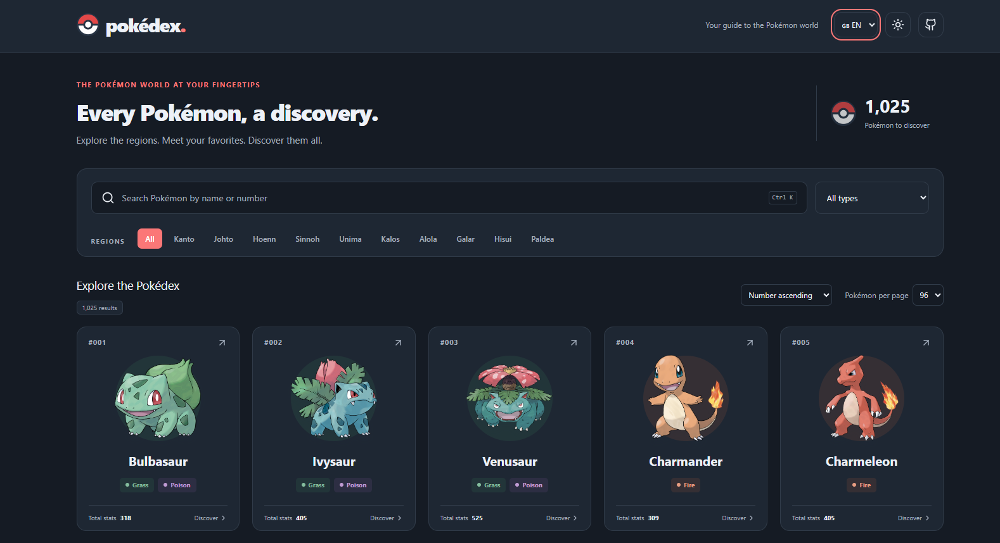

# PokedexApp

A responsive web Pokédex. Browse Pokémon, filter the catalog and explore their statistics and evolutions. Inspired by [lazyjinchuriki's Pokédex](https://github.com/lazyjinchuriki/pokedex).

## Contents

- [Repository Structure](#repository-structure)
- [Tech stack](#tech-stack)
- [Features](#features)
- [Screenshots](#screenshots)
- [Requirements](#requirements)
- [Installation](#installation)
- [Usage](#usage)
- [Tests and build](#tests-and-build)
- [Troubleshooting](#troubleshooting)
- [Credits](#credits)

## Repository Structure

```text
PokedexApp/
|-- docs/
|   `-- screenshots/
|       |-- base statistics.png
|       |-- catalog.png
|       `-- shiny and evolutions.png
|-- public/
|   `-- favicon.svg
|-- src/
|   |-- App.jsx
|   |-- api.js
|   |-- main.jsx
|   |-- pokemon.js
|   |-- styles.css
|   `-- translations.js
|-- tests/
|   `-- pokemon.test.js
|-- .gitignore
|-- index.html
|-- package-lock.json
|-- package.json
|-- README.md
`-- vite.config.js
```

## Tech stack

[](https://react.dev/)
[](https://developer.mozilla.org/en-US/docs/Web/JavaScript)
[](https://tailwindcss.com/)
[](https://vite.dev/)
[](https://nodejs.org/)
[](https://www.npmjs.com/)
[](https://lucide.dev/)

- **React and JavaScript:** interface, state management and application logic.
- **Tailwind CSS and custom CSS:** styling, themes and responsive layout.
- **Vite:** development server and production build.
- **Node.js and npm:** development tools, dependency installation and automated tests using Node's built-in test runner.
- **Lucide React:** interface icons.
- **PokéAPI:** Pokémon data, with artwork from the PokeAPI sprites repository.

## Features

- National species catalog loaded from PokéAPI.
- Search by name or national Pokédex number, with region and type filters.
- Sorting by number or name, with 24, 48 or 96 Pokémon per page.
- Detail dialogs with descriptions, abilities, base statistics and evolution chains.
- Normal and shiny artwork, with navigation between Pokémon.
- Italian and English interface, dark and light themes.
- Responsive layout and the `Ctrl+K` / `Cmd+K` search shortcut.
- Saved theme, language and page-size preferences, plus API response caching.

## Screenshots

The screenshots show the English interface in dark mode.

### Pokémon catalog

Search, filters, sorting and Pokémon cards, with 96 Pokémon per page selected.



### Base statistics

Infernape's detail dialog with individual statistics and their total.


### Shiny artwork and evolutions

Torterra's detail dialog with shiny mode enabled and its evolution chain.


## Requirements

- Node.js 22.12 or later and npm.
- A modern browser.
- Internet access to PokéAPI and its artwork repository.

## Installation

Open a terminal in the project directory, where `package.json` is located. From the Development directory:

```powershell
npm install
npm run dev
```

Open the local address printed by Vite. Keep the terminal running while using the app and press `Ctrl+C` to stop the server. Do not open `index.html` directly.

## Usage

On first launch, the app uses dark mode, Italian, all regions and 24 Pokémon per page. Change the language and theme in the header; these preferences and the page size are saved in the browser.

Search for a name such as `Pikachu` or a number such as `25`. Combine the search with region and type filters, then choose the sorting order and page size.

Select a Pokémon card to open its details. Switch between Overview, Stats and Evolutions, toggle shiny artwork, or select a Pokémon in the evolution chain. Previous and Next navigate through the catalog.

## Tests and build

| Command           | Purpose                                   |
| ----------------- | ----------------------------------------- |
| `npm install`     | Install project dependencies.             |
| `npm run dev`     | Start the development server.             |
| `npm test`        | Run the automated tests in `tests/`.      |
| `npm run build`   | Generate the production files in `dist/`. |
| `npm run preview` | Preview the generated build locally.      |

Stop the development server or open another terminal in the project directory, then run:

```sh
npm test
npm run build
npm run preview
```

For static hosting, publish the contents of `dist/`. Preview is for local verification; it does not publish the app. Rebuild after changing source files to update the preview.

## Troubleshooting

| Problem                            | Check                                                                                                       |
| ---------------------------------- | ----------------------------------------------------------------------------------------------------------- |
| npm cannot find `package.json`     | Open the terminal in the project directory shown above.                                                     |
| `vite` is not recognized           | Run `npm install` successfully before starting the app.                                                     |
| No Pokémon or artwork appear       | Check Internet access to PokéAPI and the artwork repository. Clear this app's session storage if necessary. |
| Preview fails or shows old content | Run `npm run build` before `npm run preview`.                                                               |

## Credits

Pokémon names and artwork belong to Nintendo, Game Freak and The Pokémon Company. Data is provided by [PokéAPI](https://pokeapi.co/). This is an educational project.
